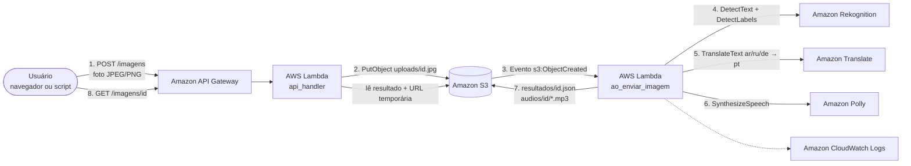

# Arquitetura — Leitor de Placas com Voz

> **Pendente:** exportar o diagrama com os **ícones oficiais da AWS** (exigência do roteiro)
> para `docs/arquitetura.png`, por exemplo no [draw.io](https://app.diagrams.net/) com a
> biblioteca *AWS Architecture Icons* ou a partir do pacote oficial em
> <https://aws.amazon.com/architecture/icons/>. O diagrama abaixo mostra o mesmo fluxo e
> serve de referência para desenhá-lo.

## Componentes

| Componente | Responsabilidade |
|---|---|
| **Amazon API Gateway** | Expõe a API REST (`GET /`, `POST /imagens`, `GET /imagens/{id}`) |
| **AWS Lambda `api_handler`** | Valida a imagem (formato e tamanho), grava no S3, consulta resultados e gera URLs temporárias dos áudios. Também serve a página web |
| **Amazon S3** | Guarda as imagens (`uploads/`), os resultados (`resultados/`) e os áudios (`audios/`). O upload em `uploads/` **gera o evento** que inicia o processamento. Bucket privado, com expiração dos objetos em 7 dias |
| **AWS Lambda `ao_enviar_imagem`** | Disparada pelo evento do S3. Encadeia os serviços de IA e grava o resultado |
| **Amazon CloudWatch Logs** | Logs das duas Lambdas (`chalice logs`) |
| **IAM Role** | Permissões mínimas definidas em `.chalice/policy-dev.json` |

## Serviços de IA e encadeamento

| Ordem | Serviço | Entrada | Saída | Uso da saída |
|---|---|---|---|---|
| 1 | **Rekognition `DetectText`** | Imagem no S3 | Linhas de texto (confiança ≥ 80%) | Entrada do Translate e da pronúncia original no Polly |
| 1 | **Rekognition `DetectLabels`** | Imagem no S3 | Até 8 rótulos da cena, em inglês (confiança ≥ 75%) | Entrada do Translate |
| 2 | **Translate** | Texto da placa (idioma detectado pelo alfabeto) e rótulos (`en`) | Texto em português | Narração em português |
| 3 | **Polly** | Narração em português + texto original | `narracao_pt.mp3` (Camila, neural) e `pronuncia_original.mp3` (voz do idioma detectado) | Resultado final para o usuário |

Vozes da pronúncia original: alemão → Vicki (neural), russo → Tatyana (standard),
árabe → Zeina (standard).

**Detecção do idioma:** feita no próprio código, pelo alfabeto das letras extraídas
(árabe → `ar`, cirílico → `ru`, latino → `de`), em `chalicelib/idiomas.py`. Alfabetos não
latinos têm prioridade em placas bilíngues. O modo `SourceLanguageCode='auto'` do
Translate não é usado porque depende do Amazon Comprehend, indisponível no plano Free
da AWS. O idioma detectado define a origem da tradução e a voz da pronúncia original.

## Regiões

| Recurso | Região | Motivo |
|---|---|---|
| Lambda, API Gateway, S3, Rekognition | `sa-east-1` | O Rekognition lê a imagem direto do bucket, que precisa estar na mesma região |
| Translate | `us-east-1` | Não existe em `sa-east-1` |
| Polly | `us-east-1` | Garante as vozes neurais usadas |

## Fluxo orientado a eventos

O cliente **não espera** o processamento na mesma requisição: `POST /imagens` responde
`202 Accepted` com um `id` logo após gravar a imagem no S3. O processamento acontece de
forma assíncrona na segunda Lambda, disparada pelo evento do S3. O cliente consulta
`GET /imagens/{id}`, que responde `202` enquanto o resultado não existe e `200` quando
ele fica pronto. Se o processamento falhar, a Lambda grava um resultado com
`"status": "erro"` em vez de relançar a exceção, para evitar que a invocação assíncrona
seja repetida e cobre os serviços de IA de novo.
